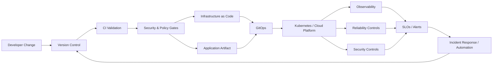

# Obinna Obika

### MLOps Engineer · LLMOps & Agentic AI Engineer · DevOps & Platform Engineer

I build and automate cloud platforms with a focus on **reliability, security, observability, repeatability, and developer experience**. My engineering work spans Infrastructure as Code, Kubernetes, CI/CD, GitOps, cloud operations, platform automation, and SRE practices. I also bring MLOps and LLMOps experience across model lifecycle management, RAG, evaluation and agentic workflows.

## Core Engineering Stack

| Domain | Technologies & Practices |
|---|---|
| **MLOps** | MLflow · Amazon SageMaker · Experiment Tracking · Model Registries · Model Deployment & Monitoring |
| **LLMOps & Agentic AI** | RAG · Embeddings & Vector Search · Prompt Evaluation · MCP · n8n · OpenAI · Anthropic Claude · Gemini · Vertex AI |
| **Cloud** | AWS · Microsoft Azure · Google Cloud Platform |
| **Infrastructure** | Terraform · Kubernetes · Docker · Helm · Linux |
| **CI/CD & GitOps** | GitHub Actions · Jenkins · Argo CD · GitOps |
| **Automation** | Python · Bash · Infrastructure Automation |
| **Observability** | Prometheus · Grafana · OpenTelemetry · CloudWatch |
| **Reliability** | SLOs · Error Budgets · Incident Response · DR · Automated Remediation |
| **Security** | IAM · RBAC · Policy as Code · DevSecOps · Supply Chain Security |
| **Platform Engineering** | Internal Developer Platforms · Golden Paths · Self-Service Infrastructure |

## Professional Experience

### Gen AI Cloud Engineer
**FedEx Ground | Pompano Beach, FL | September 2022 – Present**

- Designed and implemented end-to-end MLOps and LLMOps pipelines integrating model development, automated testing, evaluation, deployment, monitoring, and lifecycle management across cloud environments.
- Integrated MLOps tools such as MLflow and Amazon SageMaker to support experiment tracking, model versioning, model registry management, and controlled deployment workflows.
- Designed, developed, and deployed Generative AI and Large Language Model (LLM) applications using Python, OpenAI, Anthropic Claude, Google Gemini, AWS, and Google Vertex AI to automate enterprise workflows and support AI-driven business solutions.
- Designed and maintained automated CI/CD pipelines for AI/ML applications using GitHub Actions, Azure DevOps, Jenkins, and Terraform, integrating code validation, container builds, model evaluation, and production deployment.
- Containerized and deployed AI/ML applications using Docker, Kubernetes, Azure Kubernetes Service (AKS), and Amazon EKS, supporting scalable model inference, workload orchestration, and high availability.
- Developed Retrieval-Augmented Generation (RAG) solutions using document ingestion, text chunking, embeddings, vector databases, semantic search, and retrieval pipelines to improve enterprise knowledge retrieval and contextual AI responses.
- Implemented prompt engineering, model evaluation, and automated testing frameworks to assess LLM response accuracy, relevance, latency, reliability, and cost before production deployment.
- Developed Python-based AI services and REST APIs to support model inference, data processing, LLM orchestration, application integration, and automated operational workflows.
- Developed observability and monitoring solutions using Prometheus, Grafana, Loki, Azure Monitor, and AWS CloudWatch to track model inference latency, API performance, application errors, resource utilization, and infrastructure health.
- Built AI agents and agentic workflows using Model Context Protocol (MCP), n8n, function calling, and REST APIs to automate multi-step engineering and operational processes.
- Automated cloud infrastructure provisioning and configuration using Terraform, Azure Bicep, and Infrastructure as Code (IaC) to establish reproducible development, testing, staging, and production environments.
- Implemented GitOps-based deployment workflows using Argo CD and Helm to manage Kubernetes application releases, configuration updates, and rollback procedures.
- Designed and managed cloud infrastructure across AWS, Microsoft Azure, and Google Cloud Platform (GCP), supporting AI application hosting, data processing, model inference, and enterprise cloud workloads.
- Implemented secure AI/ML infrastructure using AWS IAM, Azure RBAC, Azure Key Vault, AWS Secrets Manager, private networking, and least-privilege access controls to protect model endpoints, credentials, and application data.
- Applied Site Reliability Engineering (SRE) principles to AI/ML platforms, including proactive alerting, incident response, root cause analysis, autoscaling, capacity planning, and service reliability improvements.
- Troubleshot production issues involving LLM applications, RAG retrieval pipelines, model-serving APIs, Kubernetes workloads, cloud networking, IAM permissions, and CI/CD deployment failures.
- Collaborated with data scientists, AI engineers, software developers, and cloud infrastructure teams to streamline model deployment, improve platform reliability, and establish standardized MLOps and DevOps practices.

### Cloud DevOps Engineer
**Hertz Inc. | Fort Lauderdale, FL | July 2019 – August 2022**

- Designed, deployed, and maintained scalable AWS and Microsoft Azure cloud infrastructure to support enterprise applications, development environments, and production workloads.
- Built and maintained CI/CD pipelines using Jenkins, Azure DevOps, Git, and GitHub to automate application builds, testing, deployments, and release management.
- Automated cloud infrastructure provisioning and configuration management using Terraform and Infrastructure as Code (IaC), improving deployment consistency and reducing manual intervention.
- Developed Python and Bash automation scripts for infrastructure provisioning, system health checks, configuration validation, deployment operations, and routine maintenance.
- Supported containerized application deployments using Docker and Kubernetes, assisting with application scalability, workload orchestration, and deployment reliability.
- Designed and maintained secure hybrid cloud connectivity using Site-to-Site VPN, Azure ExpressRoute, and AWS Direct Connect, supporting enterprise cloud migration and integration initiatives.
- Configured and managed cloud networking components, including AWS VPCs, Azure Virtual Networks, subnets, routing tables, security groups, load balancers, and DNS services.
- Implemented infrastructure and application monitoring using Grafana, Nagios, and cloud-native monitoring tools to track system availability, application performance, and infrastructure utilization.
- Supported DevOps release management processes, including deployment validation, environment configuration, troubleshooting, and rollback procedures.
- Implemented cloud security practices using AWS IAM, Azure RBAC, access controls, and secure configuration management to protect infrastructure and applications.
- Participated in production incident response, root cause analysis, backup and recovery operations, and infrastructure troubleshooting to improve service reliability.
- Developed technical documentation, operational runbooks, architecture diagrams, deployment procedures, and incident reports to support engineering operations and knowledge sharing.
- Collaborated with software development, infrastructure, networking, and security teams to improve deployment automation, troubleshoot production issues, and maintain reliable cloud environments.

### Scrum Master
**Venture Forwarding Inc. | Miami, FL | August 2015 – April 2019**

- Facilitated Agile Scrum ceremonies, including Daily Stand-ups, Sprint Planning, Sprint Reviews, Sprint Retrospectives, and Backlog Refinement to support efficient software development and delivery.
- Collaborated with software developers, DevOps engineers, QA teams, Product Owners, and stakeholders to coordinate application development, testing, infrastructure changes, and production releases.
- Supported Agile software delivery and DevOps practices by coordinating CI/CD activities, deployment schedules, release planning, and cross-functional technical dependencies.
- Managed sprint backlogs, user stories, acceptance criteria, and delivery priorities using Jira and Confluence to maintain alignment with business requirements and engineering objectives.
- Monitored sprint velocity, burndown charts, cycle time, and delivery metrics to identify bottlenecks, improve workflow efficiency, and strengthen delivery predictability.
- Facilitated collaboration between development, infrastructure, and operations teams to resolve technical blockers, manage dependencies, and improve application release readiness.
- Promoted continuous integration, automated testing, and continuous delivery practices by helping engineering teams incorporate DevOps activities into Agile sprint planning.
- Coordinated production release readiness, change management activities, risk assessments, and post-release reviews to support stable application deployments.
- Conducted sprint retrospectives, identified process inefficiencies, and implemented continuous improvement initiatives to strengthen team productivity, software quality, and operational efficiency.
- Maintained Agile project documentation, sprint reports, delivery dashboards, and stakeholder communications to ensure transparency, accountability, and consistent project execution.

## Education

- Associate of Science (A.S.) in Applied Technology · Universal Technical Institute, Miramar, FL
- Bachelor of Arts (B.A.) · Lagos State University, Nigeria

## Certifications

- Microsoft Certified: DevOps Engineer Expert (AZ-400)
- Microsoft Certified: Azure Administrator Associate (AZ-104)
- AWS Certified Solutions Architect – Associate

## AI Portfolio Roadmap — Proposed Projects

These proposals reflect the MLOps and LLMOps skills in my resumes. They are **planned portfolio work**, with no completed implementation, production deployment or benchmark results claimed here.

- **MLOps model delivery lab:** propose a Python model workflow with MLflow experiment tracking and registry, a SageMaker deployment option, CI evaluation gates, versioned artifacts, monitoring and rollback. Completion evidence should include runnable code, reproducible data, test results and a deployment guide.
- **RAG evaluation and delivery lab:** propose document ingestion, embeddings and retrieval, cited responses, a versioned evaluation dataset, and quality/latency/cost checks before release. Completion evidence should include the application, evaluation reports and documented failure cases.
- **Agentic operations lab:** propose an MCP or n8n workflow with allowlisted tools, human approval for infrastructure changes, audit logs and recovery behavior. Completion evidence should include a runnable workflow and tests for denied actions and partial failures.

Professional AI experience described in my resumes is separate from these public portfolio proposals. Existing repositories below provide inspectable DevOps, platform and reliability reference work.

## Featured Engineering Projects

### ☁️ [Cloud Platform Engineering](https://github.com/obinna-obika-devops/cloud-platform-engineering)
**AWS · EKS · Terraform · Kubernetes · Helm · Argo CD · Prometheus · Grafana**

Internal developer platform architecture that turns cloud and Kubernetes primitives into a controlled self-service path. Includes Infrastructure as Code, GitOps delivery, workload isolation, observability, policy controls, SLOs, incident response, and disaster-recovery patterns.

### 🔄 [Infrastructure GitOps Engineering](https://github.com/obinna-obika-devops/infrastructure-gitops-engineering)
**Terraform · GitOps · Kubernetes · Argo CD · OPA · Python**

Infrastructure change-management system built around Git as the source of truth, environment promotion, policy gates, continuous reconciliation, drift detection, auditability, and rollback planning.

### 🧰 [Platform Engineering Portal](https://github.com/obinna-obika-devops/platform-engineering-portal)
**Python · FastAPI · Terraform · GitOps · Service Catalogs · Golden Paths**

Self-service platform control plane that translates developer requests into validated infrastructure plans while preserving governance, policy, and approval boundaries.

### 📈 [SRE Reliability Engineering Lab](https://github.com/obinna-obika-devops/sre-reliability-engineering-lab)
**SRE · Kubernetes · Prometheus · Grafana · OpenTelemetry · Python**

Reliability engineering environment covering SLIs/SLOs, error budgets, telemetry, Kubernetes reliability controls, controlled failure injection, incident response, and safe remediation automation.

### 🔐 [DevSecOps Supply Chain Security](https://github.com/obinna-obika-devops/devsecops-supply-chain-security)
**GitHub Actions · Trivy · Checkov · Gitleaks · Cosign · Kyverno · OPA**

Defense-in-depth software delivery controls spanning source, dependencies, infrastructure, containers, artifacts, and Kubernetes. Includes SBOM/provenance patterns, keyless signing, policy-as-code, and admission controls.

### 💰 [Cloud FinOps Cost Optimization](https://github.com/obinna-obika-devops/cloud-finops-cost-optimization)
**AWS · Terraform · Python · FinOps · Cost Analytics · Policy Automation**

Cloud cost engineering patterns for allocation, budgets, forecasting, anomaly detection, rightsizing, and governance using synthetic billing data and infrastructure examples.

## How I Approach Platform Reliability

The operating model is consistent across the projects: **version changes, validate early, automate delivery, enforce least privilege, measure reliability, expose meaningful telemetry, reduce blast radius, and make recovery repeatable.**

## Engineering Principles

- **Automate repeatable work** rather than relying on manual operational steps.
- **Treat infrastructure as software** with version control, validation, review, and reproducible delivery.
- **Design for failure** using health checks, SLOs, observability, recovery procedures, and controlled failure testing.
- **Build security into delivery** through identity, policy, scanning, artifact integrity, and deployment controls.
- **Create paved roads for developers** that improve velocity without bypassing operational or governance boundaries.
- **Keep changes observable and reversible** so teams can detect problems quickly and recover safely.

## Additional Engineering Work

[Multi-Cloud Platform Engineering](https://github.com/obinna-obika-devops/multi-cloud-platform-engineering) · [Cloud Automation Engineering](https://github.com/obinna-obika-devops/cloud-automation-engineering) · [Cloud Networking Engineering](https://github.com/obinna-obika-devops/cloud-networking-engineering) · [Cloud Zero Trust Security](https://github.com/obinna-obika-devops/cloud-zero-trust-security) · [Cloud Migration Engineering](https://github.com/obinna-obika-devops/cloud-migration-engineering) · [Kubernetes Platform Operator](https://github.com/obinna-obika-devops/kubernetes-platform-operator)

## Repository Scope

These repositories are engineering reference implementations and labs. Each project documents its own scope and distinguishes implemented artifacts from infrastructure that would require an external cloud account or production environment to deploy. Synthetic data is identified where used.

---

### Obinna Obika
**MLOps · LLMOps · Agentic AI · DevOps · SRE · Platform & Cloud Engineering**

[Portfolio](https://obinna-obika-devops.github.io/obinna-obika-devops/) · [Case studies](https://case-studies.bilolomedia.com)

